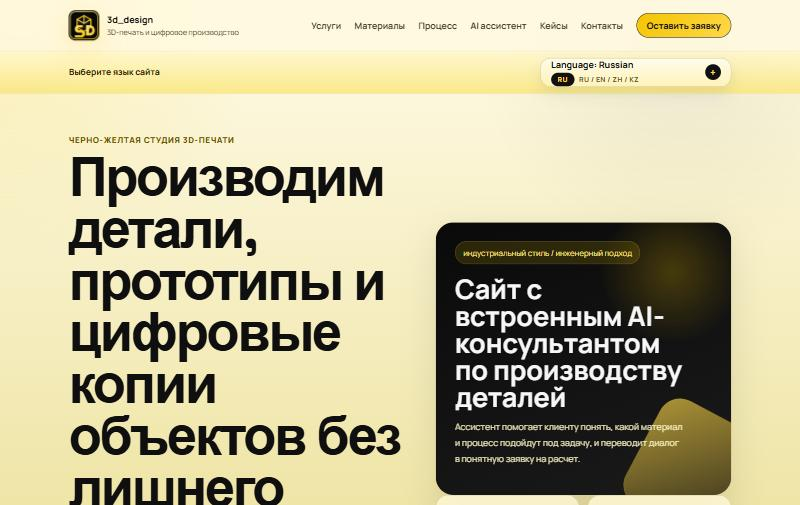

# 3D Design — сайт студии 3D-печати с AI-консультантом

**Live:** https://printdesign-3d-three.vercel.app

> Website for a 3D printing studio in Kazakhstan: an AI consultant that turns a visitor's question into a structured lead, and lead delivery (with file attachments) straight to Telegram.



## Задача

Клиенты студии 3D-печати часто не знают, какой материал и технология им нужны, и пишут в мессенджеры одно и то же: «сколько стоит», «можно ли по фото». Менеджер тратит время на одинаковые ответы, а заявки теряются в переписке.

## Решение

- **AI-консультант на сайте** уточняет у клиента материал, размеры и наличие модели и подводит к заявке.
- **Форма заявки с файлом** (фото, STL, STEP, PDF, архив) — заявка и вложение сразу приходят владельцу в Telegram.
- **Уведомления о диалогах**: каждое обращение к AI-консультанту дублируется в Telegram, чтобы владелец видел интерес клиентов.
- **SEO-страницы услуг**: 3D-печать, 3D-сканирование, реверс-инжиниринг, прототипирование, изготовление деталей.
- Мультиязычный интерфейс: RU / EN / ZH / KZ.

## Технологии

| Часть | Что использовано |
|---|---|
| Фронтенд | HTML, CSS, JavaScript без фреймворков |
| Бэкенд | Python (только стандартная библиотека), `http.server` |
| AI | Cloudflare Workers AI (`gpt-oss-20b`); также поддерживаются OpenAI, Hugging Face, Ollama |
| Уведомления | Telegram Bot API |
| Хостинг | Vercel (статика + Python-функции в `api/`) |

## Безопасность

- Ограничение частоты запросов по IP для чата и формы
- Проверка `Origin` / `Referer` — API нельзя вызвать с чужого сайта
- Проверка типа и содержимого загружаемых файлов, лимит размера
- Ключи и токены только в переменных окружения, в репозитории их нет

## Структура

- `index.html`, `services/` — страницы сайта
- `css/style.css`, `js/main.js` — стили, логика интерфейса, чата и формы
- `server.py` — API: AI-прокси, приём заявок, отправка в Telegram
- `api/` — точки входа для Vercel (`/api/chat`, `/api/contact`, `/api/track`, `/api/metrics`)
- `client_bot.py` — Telegram-бот для клиентов (запускается отдельно, требует постоянно работающий сервер)

## Локальный запуск

1. Скопируйте `.env.example` в `.env` и заполните:
   - `AI_PROVIDER` и ключ выбранного провайдера (например, `CLOUDFLARE_ACCOUNT_ID` и `CLOUDFLARE_API_TOKEN`)
   - `LEADS_TELEGRAM_BOT_TOKEN` и `LEADS_TELEGRAM_CHAT_ID`
2. Запустите сервер:

```powershell
python server.py
```

3. Откройте http://127.0.0.1:8000

Chat ID можно узнать helper-скриптом (сначала напишите боту `/start`):

```powershell
python get_telegram_chat_id.py
```

## Деплой на Vercel

1. Импортируйте репозиторий в Vercel (Framework Preset: Other — уже задан в `vercel.json`).
2. Задайте переменные окружения: `AI_PROVIDER`, ключи провайдера, `LEADS_TELEGRAM_BOT_TOKEN`, `LEADS_TELEGRAM_CHAT_ID`, `INTERNAL_ANALYTICS_ENABLED=0`.
3. Redeploy.

На Vercel лимит вложения — 3 МБ (ограничение платформы на размер запроса).

---

Автор: [Yaroslav](https://github.com/Stalker-a) — AI-боты, автоматизация и веб-приложения для бизнеса.
